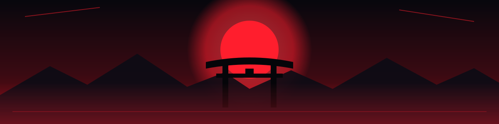

<div align="center">




Building my frontend skills one component, page, and project at a time.

<br/>


<br/>


</div>


## 📊 Learning progress

> Progress is a self-assessment of my learning journey, not a measure of
> professional mastery.

### Overall roadmap


| Stage | Status | Progress |
| :--- | :--- | :---: |
| 🟢 **Basic** | Completed |  |
| 🟡 **Intermediate** | In progress |  |
| ⚪ **Advanced** | Pending |  |

*Overall roadmap progress is approximately ~50% when the three stages are
weighted equally. Intermediate progress is an initial estimate and can
be updated as I complete topics.*


## 🧭 Roadmap

### 🟢 Phase 1 — Basics · Completed

I have covered these concepts at a foundational level and am now
building on them through practice.

- [x] HTML: semantic structure, forms, and accessibility basics
- [x] CSS: box model, selectors, specificity, and the cascade
- [x] Flexbox and Grid for layouts
- [x] Responsive design: media queries and mobile-first thinking
- [x] JavaScript fundamentals: variables, functions, arrays, objects, ES6+
- [x] DOM manipulation and event handling
- [x] Async JavaScript: promises, `async/await`, and the Fetch API
- [x] Git, GitHub, npm, and browser DevTools basics

### 🟡 Phase 2 — Intermediate · In progress

My current focus is understanding how frontend features fit together and
writing them more reliably.

- [x] **React:** components, props, state, and the rendering model
- [x] **Hooks:** `useState`, `useEffect`, `useRef`, `useContext`, and custom hooks
- [x] **Routing:** client-side navigation with React Router
- [x] **Forms:** controlled inputs, validation, and user feedback
- [x] **API integration:** Fetch/Axios, loading states, and error states
- [x] **Authentication on the client:** login flows, protected routes, and token handling
- [x] **Styling at scale:** Tailwind CSS, CSS modules, and design consistency
- [ ] **State management:** Context API, then Redux Toolkit or Zustand
- [ ] **Project structure:** components, pages, hooks, services, and utilities
- [ ] **Browser storage:** localStorage, sessionStorage, and cookie basics
- [ ] **Real-time basics:** Socket.IO client fundamentals
- [ ] **Deployment:** Vercel/Netlify, environment variables, and build errors

### ⚪ Phase 3 — Advanced · Pending

Next, I want to move beyond building screens and learn how to
design fast, accessible, scalable frontends.

- [ ] **TypeScript:** typing props, state, API responses, and events
- [ ] **Next.js:** SSR, SSG, routing, and data fetching
- [ ] **Performance:** Core Web Vitals, code splitting, lazy loading, and memoization
- [ ] **Canvas API:** drawing, pointer events, and rendering loops
- [ ] **Scalable real-time UIs:** reconnection, optimistic updates, and state sync
- [ ] **Advanced state design:** server state vs client state, caching with TanStack Query
- [ ] **Accessibility (a11y):** keyboard navigation, ARIA, and color contrast
- [ ] **Testing strategy:** unit, component, and end-to-end tests
- [ ] **Animation:** CSS transitions, Framer Motion, and motion that serves the UI
- [ ] **Frontend security:** XSS awareness and safe handling of user content
- [ ] **Tooling and CI/CD:** Vite, linting, formatting, and automated checks
- [ ] **Architecture:** design systems, reusable component libraries, and trade-offs


## 🛠️ Tech stack

| Technology | Purpose |
| :--- | :--- |
| **HTML5** | Structure and semantics |
| **CSS3** | Styling, layout, and responsiveness |
| **JavaScript** | Frontend programming |
| **React** | Component-based UI |
| **React Router** | Client-side routing |
| **Tailwind CSS** | Utility-first styling |
| **Axios / Fetch** | API communication |
| **Socket.IO Client** | Real-time communication |
| **Vite** | Dev server and build tool |
| **Git & GitHub** | Version control |
| **Browser DevTools** | Debugging and performance checks |

## 🚀 Applying what I learn — SketchVerse

My goal is to apply these concepts to the frontend of my upcoming project which i planned for a long time ,named -> **SketchVerse**, a multiplayer
drawing-and-guessing game, inspired by the web-app game -> "skribbl.io". Some of its features are : 

- Login and registration screens with protected routes
- Lobby UI: create a room, join a room, and see the player list
- Real-time drawing canvas with brush, colors, eraser, and undo
- Live chat and guess input with instant feedback
- Round timers, scoreboards, and game-state transitions
- Responsive layout for desktop and mobile
- Clear loading, error, and reconnection states

The long-term goal is to understand not only how to make an interface look good,
but also how to make it **fast, accessible, and maintainable**.

## 🔁 How I learn

1. **Understand** the concept and why it is needed.
2. **Build** a small working implementation.
3. **Test** normal and edge cases, including different screen sizes.
4. **Debug** errors and understand their causes.
5. **Refactor** toward cleaner, more reusable components.
6. **Apply** the concept to a real project.

## ▶️ Run a practice project(Basic)

```bash
git clone https://github.com/BilalAhmad7777/FRONTEND-LEARNING.git
cd FRONTEND-LEARNING

# Enter the specific project folder
cd FRONTEND-LEARNING/17-gallery-projecy


npm install
npm run dev
```

*Note : The project(s) made in this repository were made for only basic learning purposes and do not showcase the full extent of my skills.I like to improve myself everyday and I am going to study about Frontend development even further in the upcoming months and get a deep knowledge of it.
Check each project's `package.json` for its actual start command. Some
projects may use `npm start` or open directly in the browser.*

### 🔐 Security reminder

Never commit `.env` files, API keys, or real user tokens, and remember that
anything shipped to the browser is visible to the user. Keep secrets on the
backend and use a safe `.env.example` to document required variables.

<div align="center">

### 🌱 Current status

**Basics: completed. Intermediate: underway. Advanced: on the roadmap.**

Learning consistently. Building practically. Improving with every project.

[](https://github.com/BilalAhmad7777)


</div>